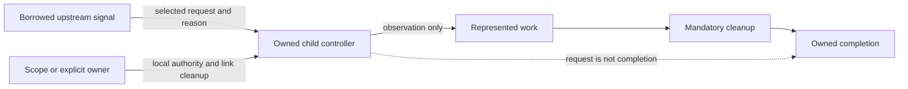

# ADR-0005: Cancellation controller and directional links

## Status

Accepted for the public native controller and its owned directional links.
Acceptance does not establish complete conformance, downstream integration, or
release authority. Other decisions apply according to their own lifecycle.

## Context

### Background and Problem Statement

The contexts package defines a structural signal capability and generic scope
composition. It leaves concrete cancellation linking and listener lifetime to
providers. This package already records independent source, link, and waiting
policies in [ADR-0002](../0002-cancellation-and-waiting/adr.md) and a reusable
scope in [ADR-0004](../0004-contexts-provider-integration/adr.md).

The provider exports `CancellationController`, a native `AbortController`
subclass that owns selected upstream links. The scope creates and closes one for
each invocation. A promise can also use an ordinary native controller directly;
supplying one deliberately shares its authority rather than creating a
directional link.

A service, session, connection, or caller-driven generator can own cancellation
links across multiple operations without retaining an artificial pending task.
The controller's added capability is independent link lifetime and observable
cleanup, not cancellation authority alone. The older timer consumer uses a
native controller and a different promise contract; it needs a separate
migration review. The inspected async-init source does not currently use this
class.

### Contexts proposals and local adoption

The contexts package's ADR-0004, reviewed at its v4.0.0 revision, retains
directional abortion and listener lifetime as deferred provider-specific
proposals. They do not become active in contexts when a provider adopts related
behavior. This record establishes an independent local contract and identifies
its upstream inputs without requiring a sibling checkout:

| Upstream input                                     | Local treatment                                                                                                                          |
| -------------------------------------------------- | ---------------------------------------------------------------------------------------------------------------------------------------- |
| Contexts ADR-0004, REQ-CONTEXTS-CAPABILITY-001     | The signal observes a request; it is not cancellation authority or completion.                                                           |
| Contexts ADR-0004, deferred REQ-CONTEXTS-ABORT-001 | Local [source policy](../0002-cancellation-and-waiting/adr.md#REQ-CANCEL-SOURCE-001) is active; this record selects a public link owner. |
| Contexts ADR-0004, deferred REQ-CONTEXTS-ABORT-002 | Local [link policy](../0002-cancellation-and-waiting/adr.md#REQ-CANCEL-LINK-001) is active; this record selects explicit owner cleanup.  |

The upstream revision is historical input, not an imported provider decision.
The timer and deadline proposals remain outside this controller decision.

### Capability and algebra boundary

This provider does not introduce a new JavaScript cancellation primitive. Native
signals and controllers can express the behavior with application-owned link and
cleanup code. A provider can nevertheless supply a substantive reusable
contract: fresh cancellation state, explicit authority, directional propagation,
reason identity, and a defined lifetime for installed links. Those observations
are observable semantic commitments, not just shorter syntax.

In the contexts operation model, a scope supplies an ordinary signal to the body
while the caller supplies any unsatisfied requirements. For example, an
operation requiring both a signal and a trace value can be wrapped by the
cancellation scope; the caller still supplies the trace and may supply an
upstream signal. Compatibility must be checked before a requirement is removed:
an ordinary signal does not satisfy a body requiring a stronger refined signal.
Projection preserves supported unrelated fields; it does not transfer hidden
lifecycle admission.

Write an operation as a function from a requirement record `R` to a promise of
result `A`. Let `P` be what a provider supplies, `D` what the scope itself
needs, and `K` the supplied keys. The following is an informative type model,
not a claim that record intersection acquires or merges resources:

$$
\mathcal{O}(R,A) = R \rightarrow \operatorname{Promise}(A),
\qquad
\operatorname{Scope}(D,P):
\mathcal{O}(R,A) \rightarrow \mathcal{O}(D \cap (R \setminus K),A).
$$

The transformation is valid only when `P` is compatible with the part of `R` it
supplies. For this provider, `P` includes an ordinary signal, while `D` may
include an optional upstream signal. A trace requirement remains with the
caller; a refined signal requirement cannot be removed unless the provider
actually supplies that refinement.

The scope is an execution layer, not merely a type-level requirement. It
acquires a fresh cancellation source, passes its child signal, and retains its
owned links through represented body work and any inner cleanup that needs them.
Unlinking is part of the cancellation scope's own cleanup; that scope's actual
completion is after its unlinking finishes. A resource scope nested inside
cancellation can observe the child signal and release before unlinking.
Reversing the order can make the resource observe the parent signal and unlink
before release. The [order test](../../tests/contexts.test.ts) is a bounded
example, not a theorem about every resource or schedule.

For compatible inert transformations, regrouping layers can preserve selected
observations while preserving order. It does not justify swapping layers.
Repeated cancellation scopes can allocate different signal identities and
listeners; they are not generally idempotent. A Boolean any-request condition
may be commutative, but two already-aborted inputs with distinct reasons can
produce different reasons when input order is reversed. Timing, request origin,
signal identity, and cleanup are also observable. Distributing one shared scope
over retries or sequential operations changes ownership and may create multiple
sources. No general commutativity, idempotence, or distributivity is claimed.

For a concrete reason-sensitive counterexample, let `p` and `q` already be
aborted with distinct reasons and let `any` select the first already-aborted
input. Both combined signals are aborted, but their reasons differ:

$$
\operatorname{reason}(\operatorname{any}(p,q)) = r_p
\ne r_q = \operatorname{reason}(\operatorname{any}(q,p)).
$$

This describes that particular selection policy, not a universal ordering law
for every cancellation combiner. Likewise, if `C` is a cancellation scope and
`R` is a resource scope, swapping their order can change the resource's signal
and release trace:

$$
\operatorname{obs}(C \circ R) \ne \operatorname{obs}(R \circ C).
$$

Here the left-hand layer is outermost, and the observations include signal
identity and cleanup order. The counterexample does not deny associativity for
compatible, inert scope construction under a separately defined observation
domain.

## Decision Drivers

### Primary Decision Drivers

- Preserve directional authority, exact reasons, and owned link cleanup.
- Make the relationship with native abort controllers honest and testable.
- Retain explicit composition and represented completion boundaries.

### Secondary Decision Drivers

- Avoid exposing an API solely for speculative reuse.
- Permit useful independent provider adoption without a task runtime.

## Considered Options

### Option 1: Keep the cancellation-specific owner

**Advantages:** Its existing cancellation and close vocabulary is explicit and
does not claim native-controller substitution.

**Disadvantages:** Consumers cannot use it as a native-shaped controller, and
closing currently revokes its local cancellation operation.

**Risk Assessment:** Documenting a public owner prematurely could freeze an
interface without a demonstrated consumer.

### Option 2: Use a native-shaped linked controller

**Advantages:** A stable signal and native-shaped `abort` operation make the
local authority familiar while directional links and their cleanup add a
provider-specific contract.

**Disadvantages:** Native-shaped behavior, link lifetime, and the meaning of
close must be specified independently. Structural compatibility does not imply
native identity or compatibility with runtime brand checks.

**Risk Assessment:** A close operation that disables later local abort would
contradict the selected native-shaped behavior. The requirement below treats
close as unlinking, not revocation.

### Option 3: Use only native primitives at each call site

**Advantages:** No additional provider controller interface is needed.

**Disadvantages:** Callers that need directional linking must separately own
propagation, setup failure, cleanup, and reason-selection policies.

**Risk Assessment:** Repeated implementations can differ in observable lifetime
and authority behavior.

### Option 4: Native authority with provider-owned internal links

**Advantages:** Native controllers express authority directly. The reusable
scope owns its links without publishing a general link or controller API.

**Disadvantages:** A separate timer owner cannot import private link machinery;
it needs its own explicitly reviewed propagation and cleanup contract.

**Risk Assessment:** A scope that enters asynchronously cannot automatically
preserve synchronous scheduling. Consumer integration needs separate evidence.

## Decision

Choose option 2 as a native subclass with publicly owned inbound links. A scope
is one owner of this controller; a long-lived domain object can own it directly
and attach or detach links across operations. Native controllers remain usable
where only local or shared authority is needed. A separate link-owner API for an
externally owned controller is not selected without a demonstrated need. This
replaces the earlier scope-only candidate within this record, not any accepted
decision.

The following requirements refine the existing local source and link
requirements without superseding them.

### REQ-CANCEL-CONTROLLER-001 - Local authority and native-shaped signal

Requirement status: active. Level: MUST. Verification: type and runtime cases.
Evidence status: partial.

The public cancellation controller MUST extend the native controller and retain
one stable signal and native first-abort and default-reason behavior. Observers
receiving only its signal MUST NOT thereby receive controller authority. An
explicitly supplied native controller shares that exact authority and signal;
requesting cancellation MUST NOT claim to stop or complete arbitrary work.

### REQ-CANCEL-CONTROLLER-002 - Directed upstream requests

Requirement status: active. Level: MUST. Verification: runtime cases. Evidence
status: partial.

Each independently owned controller MUST have independent cancellation state;
explicitly shared controllers are not independent. When an upstream link is
selected, pre-existing and later upstream requests MUST reach the child with the
original reason. A local request MUST NOT abort the upstream or independent
siblings without separate authority. Disabling a selected propagation path MUST
be explicit.

### REQ-CANCEL-CONTROLLER-003 - Link close is not local abort revocation

Requirement status: active. Level: MUST. Verification: runtime cases. Evidence
status: partial.

Close MUST attempt to remove every owned upstream link without itself aborting
the child or claiming work completion. It MUST disable upstream propagation even
if unlinking fails. A later explicit local `abort` MUST remain effective if the
child is not already aborted. The link owner MUST retain links through
represented work and mandatory cleanup when those obligations depend on them.
Logical closure MUST disable forwarding even when physical removal fails; such a
failure remains observable and does not assert listener removal. Repeated close
MUST retry failed removals and MUST NOT repeat successful removals.

### REQ-CANCEL-CONTROLLER-004 - Setup and release failures remain visible

Requirement status: active. Level: MUST. Verification: runtime failure cases.
Evidence status: partial.

The link owner MUST unwind links installed before setup fails and attempt every
owned unlink during close. If primary setup or body work and cleanup both fail,
the cleanup failure MUST be the `error` and the primary failure the `suppressed`
value of a `SuppressedError`. Multiple peer unlink failures MUST be retained in
an `AggregateError` used as the cleanup failure. A lone primary or cleanup
failure MUST retain its identity. Cleanup MUST NOT be represented as completion
of work.

### REQ-CANCEL-CONTROLLER-005 - Multi-input policies are conditional and explicit

Requirement status: active. Level: MUST. Verification: runtime cases. Evidence
status: partial.

If a controller offers multiple upstream inputs, it MUST specify selection,
already-aborted input order, duplicate handling, reason identity, and link
ownership. An offered any-source policy MUST conform to the active local source
requirement. This requirement alone does not mandate a multi-input API.

### REQ-CANCEL-CONTROLLER-006 - Publication is a separate provider decision

Requirement status: active. Level: MUST. Verification: API and consumer review.
Evidence status: partial.

Before exposing a controller or associated authority type publicly, the provider
MUST specify its supported operation shapes, lifetime, naming, consumer use
cases, and native compatibility boundary. Public exposure MUST NOT be inferred
from signal observation or from contexts composition alone.

### REQ-CANCEL-CONTROLLER-007 - Individually owned dynamic links

Requirement status: active. Level: MUST. Verification: runtime and type cases.
Evidence status: partial.

The controller MUST provide dynamic upstream attachment and an individual detach
operation for each attachment. Duplicate attachments to one upstream signal MUST
share one physical listener and remain independently detachable; the last detach
removes the listener. A pre-aborted input MUST request abortion with its
original reason. A closed owner MUST reject new attachments; an already-aborted
owner MAY return an inert detach because no further request can change its
signal.

Detach MUST disable forwarding before attempting the final physical removal.
Failed removal MUST be observable and remain retryable by that detach or by
close; successful repeated detach MUST be inert. Setup failure MUST unwind its
own partial installation while retaining any cleanup failure. The owner MUST NOT
describe successful logical closure as proof that a failed physical removal
occurred.

While the owner is open and not already aborted, reentrant attachment to the
same signal during installation or removal MUST fail rather than claim an
incomplete link. A reentrant close that encounters an in-progress removal MUST
report that incomplete removal while still attempting the other links; a later
close can retry an unsuccessful removal.

## Consequences

### Positive

Operation scopes and independently lived domain objects can own directional
links while keeping request observation and actual work completion distinct.

### Negative

Public link lifetime, duplicate attachment, failure, and native compatibility
require explicit tests and documentation. A controller is not a scheduler or a
completion handle.

### Neutral

Scope nesting, application policy, timer scheduling, and lifecycle admission
remain independently owned. A shared native controller is different from an
independently owned controller linked to an upstream signal.

## Decision Outcome

Accept a public native controller with individually owned inbound links and a
scope adapter. Existing active local requirements continue to bind until an
accepted follow-on changes them.

## Related Decisions

- [Cancellation and waiting](../0002-cancellation-and-waiting/adr.md).
- [Contexts provider integration](../0004-contexts-provider-integration/adr.md).

## Links

- [Current cancellation owner](../../src/CancellationController.ts).
- [Current cancellation scope](../../src/utils.ts).
- [Directional cancellation cases](../../tests/cancellation.test.ts).
- [Scope and order cases](../../tests/contexts.test.ts).
- [Target-to-case bindings](cases.yml).

## More Information

The provider's promise facade and represented completion boundary require a
separate decision. A cancellation request is neither a join nor a resource
release. No browser execution or consumer integration is implied by acceptance.

## Audit

### 2026-11-10

**Status:** Pending

**Findings:**

| Finding                 | Files                                               | Lines        | Assessment                                             |
| ----------------------- | --------------------------------------------------- | ------------ | ------------------------------------------------------ |
| Existing local policies | [ADR-0002](../0002-cancellation-and-waiting/adr.md) | Requirements | Active; evidence is partial                            |
| Earlier candidate       | [Owner](../../src/CancellationController.ts)        | Whole file   | Earlier public shape and post-close behavior changed   |
| Composition evidence    | [Tests](../../tests/contexts.test.ts)               | Order case   | Candidate test is bounded, not independent conformance |

**Summary:** This draft proposes independent provider requirements and
identifies current implementation differences. No target is accepted or verified
here.

**Action Required:** Review native authority, private link ownership, public
need, upstream mapping, and multi-input scope; validate the record and its
evidence before any decision is accepted.

### 2026-11-10

**Status:** Partial

**Findings:**

| Finding                | Files                                       | Lines         | Assessment                                                     |
| ---------------------- | ------------------------------------------- | ------------- | -------------------------------------------------------------- |
| Link and failure roles | [Cases](../../tests/cancellation.test.ts)   | Failure cases | Local cases exercise setup, unlink, and nested failure roles   |
| Consumer integration   | [Scope cases](../../tests/contexts.test.ts) | Whole file    | Timer and lifecycle ownership are not yet independently tested |

**Summary:** The candidate at this review used a private owner and retained the
accepted body-versus-cleanup failure distinction. Local test evidence did not
settle the public API or prove another provider's link lifetime.

**Action Required:** Prove timer and lifecycle integration, review public API
need, and retain proposed status until the targets are reviewed.

### 2026-11-10

**Status:** Partial

**Findings:**

| Finding                   | Files                                                                                        | Lines              | Assessment                                                 |
| ------------------------- | -------------------------------------------------------------------------------------------- | ------------------ | ---------------------------------------------------------- |
| Independently owned links | [Controller](../../src/CancellationController.ts), [cases](../../tests/cancellation.test.ts) | Dynamic cases      | Public candidate supports attachment and individual detach |
| Downstream adoption       | [Waiting proposal](../0006-waiting-and-owned-completion/adr.md)                              | Integration review | Timer and lifecycle integration remain unverified          |

**Summary:** A long-lived domain object needs independently controlled link
lifetimes, invalidating the earlier scope-only assumption. Local cases do not
establish downstream integration or accept the decision.

**Action Required:** Review duplicate and failure policies and validate the
public contract and its bounded evidence before acceptance.

### 2026-11-10

**Status:** Partial

**Findings:**

| Finding             | Files                                                                                        | Lines                     | Assessment                                                                  |
| ------------------- | -------------------------------------------------------------------------------------------- | ------------------------- | --------------------------------------------------------------------------- |
| Controller contract | [Controller](../../src/CancellationController.ts), [cases](../../tests/cancellation.test.ts) | Dynamic and failure cases | Public native authority and owned link policies were reviewed and selected  |
| Local evidence      | [Cases](cases.yml)                                                                           | All cases                 | Runtime and type cases are bounded; integration evidence remains incomplete |
| Execution decision  | [ADR-0003](../0003-owned-execution/adr.md)                                                   | Requirements              | Acceptance here does not change the active execution obligations            |

**Summary:** The public controller decision is accepted following review of the
long-lived ownership use case, native compatibility, duplicate links, cleanup
failure, and local cases. Acceptance is not a release or downstream
verification.

**Action Required:** Maintain the bounded cases, resolve the separate execution
decision drift, and verify downstream integration in its own migration.
