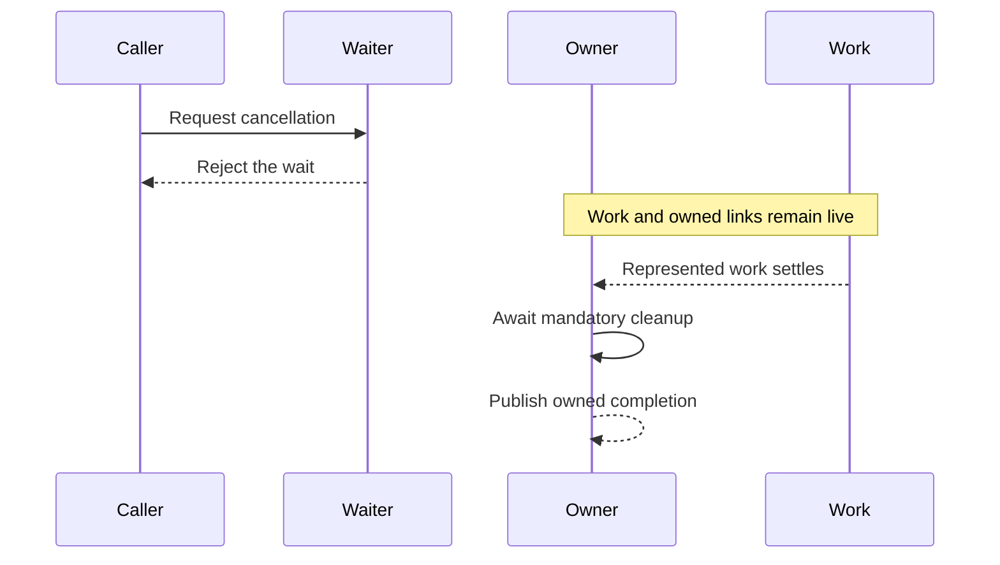

# ADR-0006: Cancellable waiting and owned completion

## Status

Accepted for the waiting, completion, promise, and scope boundaries below. This
record supersedes ADR-0003 and one requirement in ADR-0004, as stated in the
decision. Acceptance, implementation evidence, consumer integration, and release
authority are separate.

## Context

### Background and Problem Statement

A cancellation request, a caller stopping its wait, represented work settling,
and mandatory cleanup finishing are distinct observations. A promise may
represent a selected result without representing every effect that continues
after it. A provider must state which work it owns rather than infer ownership
from an opaque promise or arbitrary detached executor effects.

The [cancellable promise](../../src/PromiseCancellable.ts) is a native promise
subclass. Direct construction requests cancellation without independently
rejecting its result. Its `from` operation explicitly selects request-only or
early waiting. The early waiter observes a later source failure but does not
expose a separate source-completion outcome. An owner must retain the source or
another completion-bearing result. Detached work not represented by executor
resolution remains outside that boundary.

[ADR-0002](../0002-cancellation-and-waiting/adr.md) already requires borrowed
waits not to own their input. [ADR-0003](../0003-owned-execution/adr.md)
originally required owner-observable completion and selected owned execution,
groups, sequences, and shared-wait policies. This record retains completion
obligations but replaces that record-level direction with conditional policies.

[ADR-0004](../0004-contexts-provider-integration/adr.md) also states that a
separate owned execution entry rejects a pre-aborted signal before body entry.
The provider no longer supplies that entry. Its scope instead invokes the body
with an already-aborted child signal. These are different entry policies and
must not be silently conflated.

### Upstream review inputs

Contexts owns generic resource completion but not this provider's waiting or
execution engine. Contexts ADR-0003, reviewed at v4.0.0, distinguishes stopping
a wait from releasing represented resources. Contexts ADR-0004 leaves concrete
cancellation and listener policies to providers.

The withdrawn contexts ADR-0012, execution ontology and semantics, is historical
input, not a binding shared edition. Its waiting, representation, and completion
proposals motivate the local requirements below. They do not require this
package to adopt every group, sequence, retry, or supervision policy. These
identifiers record provenance; this decision states the local contract without
requiring a sibling checkout.

### Shared vocabulary and boundaries

The following vocabulary follows the accepted contexts operation and ownership
model. The withdrawn contexts execution ontology is useful historical
explanation, not an independently binding shared edition.

| Term                           | Meaning in this provider                                                                                                                      |
| ------------------------------ | --------------------------------------------------------------------------------------------------------------------------------------------- |
| Operation                      | Deferred context-dependent work; invoking it begins an execution.                                                                             |
| Execution                      | One invocation and the work it represents, not necessarily a new scheduled task.                                                              |
| Scope                          | A boundary that supplies capabilities and retains its declared obligations through represented work and mandatory cleanup.                    |
| Owner and borrower             | An owner has a declared responsibility or authority; a borrower can use a capability without acquiring its release or cancellation authority. |
| Cancellation source and signal | The source has cancellation state and authority; the signal exposes a request and its reason, not that authority.                             |
| Directed link                  | A selected propagation path from an upstream signal to a downstream source; it does not establish ownership of upstream work.                 |
| Waiter and waiting result      | An observer and the result it waits on; that result can settle before represented work and cleanup finish.                                    |
| Work settlement                | Fulfillment or rejection of work represented at a named boundary.                                                                             |
| Actual completion              | Represented work settlement followed by all mandatory cleanup and owned obligations at that boundary.                                         |

An owner-observable completion outcome is how an owner can observe that actual
completion boundary and its failures. It is not a new general meaning of
completion. Here, cancellation source means cancellation state and authority;
source promise means a promise representing work or a result. One is not the
other. Parent and child describe only a specified nesting or directed
cancellation relationship, not necessarily a task tree, ownership transfer, or
result dependency.

### A chain with ordinary, non-cooperative work

Imagine asking a printer to produce a report and then notify someone when it is
ready. The caller can stop waiting, but the printer may continue printing. An
ordinary promise can represent that printing; it need not be a cancellable
promise instance. Cancelling a waiting facade cannot force a printer or another
function to stop if it does not cooperate with the request.

The following is an illustrative TypeScript example. Assume `writeReport` has
started, returns an ordinary promise representing the print, remains pending
until after cancellation, and does not observe a signal:

```typescript
import { PromiseCancellable } from '@matrixai/async-cancellable';

declare function writeReport(): Promise<string>;
declare function notify(report: string): Promise<void>;

const work = writeReport();
const waiter = PromiseCancellable.from(work, { policy: 'early' });
const chain = waiter.then((report) => notify(report));

waiter.cancel(new Error('caller stopped waiting'));

try {
  await chain;
} catch (reason) {
  // The wait was cancelled; this does not establish that work has finished.
}

try {
  await work;
} catch (reason) {
  // The owner observes a separate failure of the represented work.
}
```

Under the explicitly selected early policy, cancellation wins the wait in this
scenario. The success callback does not start, `chain` rejects, and `work` can
remain pending. The owner retains `work` to observe its later settlement; if
work needs further mandatory cleanup, the owner must also retain that cleanup
before reporting actual completion.

There is a different case when a success callback has already started and
returns an ordinary promise for a slow next step. The returned chain normally
waits for that promise to settle through native promise assimilation, but
neither the native promise nor the chain is automatically interruptible.
Cancelling an earlier facade does not retroactively stop the started callback or
guarantee a request reaches that next step. The provider gives each chain result
an independent signal and passes that signal to its callback. A callback must
explicitly pass or observe it for the next step to cooperate.

An ordinary promise-returning operation can be cooperative when it is explicitly
given a signal and its implementation observes it. Conversely, even a promise
called cancellable cannot force an opaque or detached effect to stop. Returning
or awaiting a promise for work is what makes that work represented by that
chain; starting an effect and discarding its completion does not. The example
shows this provider's boundary, not a claim that every future provider policy
has been accepted or independently verified.

### Timer and lifecycle integration review

A timer that starts scheduling synchronously cannot assume a deferred scope has
already entered. A candidate timer owns its scheduling handle and a
completion-bearing result. It could use a public cancellation controller to own
inbound links independently of an operation scope. If a caller supplies a native
controller, its exact controller and signal are shared authority; linking a
separate upstream signal to that externally owned controller needs an explicit
ownership choice. The public linked controller cannot replace a supplied native
controller while preserving its identity. A provider scope may instead supply an
upstream signal when its deferred entry and projection rules fit the caller.

Under the candidate migration, an upstream request before handler entry clears
the schedule and rejects with the exact reason. Once a handler has started, the
request reaches its signal, but the completion-bearing result waits for the
represented handler and mandatory cleanup even if the handler ignores it. An
early waiter can wrap that result externally. Reset and refresh while pending
reschedule the same execution, source, and result. The historical eager and lazy
options, and the custom-controller path that bypasses pre-handler rejection,
require explicit breaking migration decisions; this proposal does not silently
preserve them.

Timer setup failure must unwind installed listeners; completion must observe
unlink failures. Pre-aborted input, scheduling synchrony, signal identity,
shared authority, handler settlement, reset, refresh, and cleanup failure need
direct consumer tests before API acceptance. This is a proposed integration
contract, not a claim that the timer currently implements it.

Likewise, lifecycle admission must enclose the actual completion-bearing
operation and its cleanup, with any early wait outside admission. Ordinary
record projection must not copy or invent participant-specific lifecycle
metadata. Identity-preserving nesting or a lifecycle-owned transform needs
concrete integration evidence; this record does not claim such evidence already
exists.

### Ownership and observation choices

An early waiter can return before work and cleanup finish. If another owner
retains the original work, that owner can observe its eventual result. An API
that itself claims to own the work needs a completion-safe result or another
owner-observable outcome; merely observing a late rejection internally prevents
an unhandled rejection but does not deliver that failure to the owner.

Possible provider designs include a request-only facade whose result settles
after represented work, a borrowed early waiter over a separately retained
completion, or an owned execution handle exposing both an early result and
completion. Each has different authority and API costs. Native promise result
combinators do not acquire or cancel their inputs merely by selecting results.
None of these choices can join detached work that was not explicitly
represented.

The following sequence is one possible execution, not a claim that these events
always happen at different times. The caller can stop waiting while the owner
still retains represented work and its cleanup:



Let `s` be a signal, `w` represented work, and `q` a caller-facing wait. Neither
an aborted signal nor settlement of that wait proves that `w` has completed:

$$
\operatorname{aborted}(s) \not\Rightarrow \operatorname{complete}(w),
\qquad
\operatorname{settled}(q) \not\Rightarrow \operatorname{complete}(w).
$$

In the early-wait execution above, the wait can settle strictly before the
owner's completion; the work and cleanup can also settle at other times. An
owned completion denotes settlement of the represented work followed by all
mandatory cleanup, with their failure roles retained. A detached effect outside
that represented boundary is not made part of it by this notation.

## Decision Drivers

### Primary Decision Drivers

- Preserve actual represented completion and failure observation for owners.
- Separate borrowed waiting from cancellation authority and work ownership.
- Make pre-aborted entry and cleanup boundaries explicit.

### Secondary Decision Drivers

- Avoid an execution runtime or public handle without a reviewed need.
- Preserve accepted requirements until a successor is explicitly accepted.

## Considered Options

### Option 1: Restore all previously selected execution policies

**Advantages:** Restores the implementation direction selected by ADR-0003 and
can expose owner-observable completion through explicit handles.

**Disadvantages:** Group, sequence, and shared-work policies require a broader
public contract, implementation, and evidence than cancellable waiting alone.

**Risk Assessment:** Reintroducing every policy without a demonstrated provider
or consumer need can enlarge the library unnecessarily.

### Option 2: Specify waiting and ownership boundaries independently

**Advantages:** Borrowed waits remain usable without implying ownership; actual
owners must retain observable completion. Additional owned combinators can be
adopted separately when justified.

**Disadvantages:** Callers choosing early waiting rejection must know how the
actual owner retains completion, and some uses may need another explicit handle.

**Risk Assessment:** Describing a facade as borrowed does not excuse hiding a
completion outcome from an owner that the facade claims to represent.

### Option 3: Treat early rejection as execution completion

**Advantages:** One caller-facing result is easy to use.

**Disadvantages:** Non-cooperative work or cleanup may continue after rejection.

**Risk Assessment:** Owners can release resources too early or lose later
failures. This option is not recommended.

## Decision

Choose option 2. Specify the facade's waiting and source boundaries separately
from any explicit owned-execution API. A completion-safe single result, a
separately retained external completion, or an owner-facing completion handle
may meet the relevant ownership need; this record does not select a new public
handle merely because early waiting exists.

This record supersedes ADR-0003 and replaces its record-level direction to
provide owned execution, groups, sequences, and shared waiting. It supersedes
[REQ-EXEC-OWNER-001](../0003-owned-execution/adr.md#REQ-EXEC-OWNER-001) with
REQ-CANCEL-COMPLETION-001 and withdraw the unconditional provider direction
associated with
[REQ-EXEC-GROUP-001](../0003-owned-execution/adr.md#REQ-EXEC-GROUP-001),
[REQ-EXEC-SEQUENCE-001](../0003-owned-execution/adr.md#REQ-EXEC-SEQUENCE-001),
and [REQ-EXEC-SHARED-001](../0003-owned-execution/adr.md#REQ-EXEC-SHARED-001).
These policies remain available for independent future adoption; they are not
prohibited. If offered, they require the explicit policies below.

REQ-CANCEL-SCOPE-ENTRY-001 supersedes
[REQ-CANCEL-CONTEXT-SCOPE-001](../0004-contexts-provider-integration/adr.md#REQ-CANCEL-CONTEXT-SCOPE-001)
only at the requirement-anchor level. It preserves the scope's other obligations
while removing the unconditional reference to a separate owned execution entry.
It does not replace ADR-0004 as a whole.

<a id="REQ-CANCEL-COMPLETION-001"></a>

### REQ-CANCEL-COMPLETION-001 - Owners retain observable completion

Requirement status: active. Level: MUST. Verification: runtime ownership cases.
Evidence status: partial.

An API claiming ownership of represented execution MUST provide the owner an
observable completion outcome covering that work and mandatory cleanup. A
request, early selected result, or abandoned wait MUST NOT discharge that
obligation or hide a later owned failure. The original primary and cleanup
failure values, including non-Error values, MUST retain their identity and both
MUST remain observable when both fail. A single completion-safe return value or
a separate completion outcome MAY satisfy the requirement. The API MUST state
what work it represents and MUST NOT claim to join detached effects.

<a id="REQ-CANCEL-WAITER-002"></a>

### REQ-CANCEL-WAITER-002 - Borrowed waiting has no inferred authority

Requirement status: active. Level: MUST. Verification: runtime waiting cases.
Evidence status: partial.

A borrowed wait MUST declare whether cancellation rejects only the wait or also
requests cancellation under explicit authority. Abandonment MUST NOT cancel,
release, or claim completion of borrowed work. Eventual rejection MUST remain
observed; observation alone MUST NOT be described as delivery of that failure to
an owner. The actual owner remains responsible for retaining its completion.

<a id="REQ-CANCEL-FACADE-001"></a>

### REQ-CANCEL-FACADE-001 - Facade settlement and completion are explicit

Requirement status: active. Level: MUST. Verification: runtime and API review.
Evidence status: partial.

The cancellable promise MUST state for each supported policy whether its
caller-facing result can settle before represented source settlement and
cleanup. Request-only behavior MUST retain its represented completion boundary.
An early rejection policy MUST NOT imply that the promise exposes a separate
completion outcome unless it actually does so. Applications needing such an
outcome MUST retain an appropriate independently accessible source or use a
contract that provides owner-observable completion.

<a id="REQ-CANCEL-PROMISE-001"></a>

### REQ-CANCEL-PROMISE-001 - Native settlement and explicit waiting

Requirement status: active. Level: MUST. Verification: runtime and type cases.
Evidence status: partial.

Direct construction MUST preserve native one-shot resolution, including
commitment to a pending thenable; a request alone MUST NOT override settlement.
The `from` boundary MUST require an explicit early or request-only policy. An
early waiter MUST NOT infer authority over its borrowed input. Supplying a
native controller MUST share its exact signal and cancellation authority,
including requests made after result settlement.

<a id="REQ-CANCEL-PROMISE-002"></a>

### REQ-CANCEL-PROMISE-002 - Independent signal-aware continuations

Requirement status: active. Level: MUST. Verification: runtime and type cases.
Evidence status: partial.

Continuation methods MUST return cancellable promise results, provide their
callback with the result's signal, and use independent controllers by default.
An explicitly supplied controller MUST instead share its authority. A request
MUST NOT by itself skip a callback, prevent recovery or finalization, or cancel
the parent or independent siblings. Native interoperability, species, thenable
assimilation, and static constructor identity MUST be tested. The supported
continuation contract returns the base cancellable promise; it does not promise
to preserve a consumer subclass's identity. Static construction follows the
selected constructor, subject to its compatible constructor contract.

<a id="REQ-CANCEL-PROMISE-003"></a>

### REQ-CANCEL-PROMISE-003 - Root surface remains deliberate

Requirement status: active. Level: MUST. Verification: runtime and type API
review. Evidence status: partial.

The root runtime surface MUST contain the cancellable promise class, the
cancellation controller, and the reusable cancellation scope. A separate
standalone link owner or separately named type-only root export MUST NOT be
added without a reviewed consumer need.

<a id="REQ-CANCEL-SCOPE-ENTRY-001"></a>

### REQ-CANCEL-SCOPE-ENTRY-001 - Scope acquisition and pre-aborted entry

Requirement status: active. Level: MUST. Verification: type and runtime cases.
Evidence status: partial.

The cancellation scope MUST be constructible without entering work or acquiring
a source. Each invocation MUST acquire its own source and provide its signal
while preserving compatible unrelated context fields and outstanding operation
requirements. It MUST NOT claim to supply a more refined signal than it owns.
When its input is already aborted, the scope MUST invoke its body with the
aborted signal; a separately offered execution entry MUST specify its own
admission policy. Source cleanup MUST follow represented body completion and
mandatory cleanup.

<a id="REQ-CANCEL-POLICY-001"></a>

### REQ-CANCEL-POLICY-001 - Additional execution policies are explicit

Requirement status: active. Level: MUST. Verification: policy and API review.
Evidence status: partial.

If the provider offers owned groups, sequences, races, or shared execution, it
MUST separately specify authority, result selection, represented completion,
failure observation, cancellation propagation, and cleanup for each offered
policy. Borrowed native result combinators MUST NOT be described as owning their
inputs. This clause does not require the provider to offer those policies.

## Consequences

### Positive

The provider can offer useful cancellable waiting without pretending that early
rejection joins work or grants authority over borrowed inputs.

### Negative

Early waiting and actual owned completion may require separate observations. The
provider does not offer the previously selected owned-execution APIs; native
result combinators do not replace their ownership and cleanup policies.

### Neutral

Non-cooperative work can remain live indefinitely. Timers, lifecycle admission,
and application supervision remain separate provider or application policies.

## Decision Outcome

Specify independent contracts for waiting, completion, and explicitly offered
execution policies. Supersede ADR-0003 and the named scope requirement in
ADR-0004 while preserving the remaining ADR-0004 requirements.

## Related Decisions

- [Cancellation and waiting](../0002-cancellation-and-waiting/adr.md).
- [Owned execution and composition](../0003-owned-execution/adr.md).
- [Contexts provider integration](../0004-contexts-provider-integration/adr.md).
- [Cancellation controller decision](../0005-cancellation-controller/adr.md).

## Links

- [Current promise facade](../../src/PromiseCancellable.ts).
- [Borrowed wait helper](../../src/utils.ts).
- [Promise and waiting cases](../../tests/PromiseCancellable.test.ts).
- [Cancellation scope cases](../../tests/cancellation.test.ts).
- [Requirement-to-case bindings](cases.yml).

## More Information

Local and hermetic checks provide bounded evidence, not complete native
interoperability or actual async-init and timer integration. Acceptance does not
grant permission to publish.

## Audit

### 2026-11-10

**Status:** Partial

**Findings:**

| Finding                      | Files                                                                 | Lines             | Assessment                                                                                      |
| ---------------------------- | --------------------------------------------------------------------- | ----------------- | ----------------------------------------------------------------------------------------------- |
| Accepted execution direction | [ADR-0003](../0003-owned-execution/adr.md)                            | Decision          | Selected implementation and test paths were removed                                             |
| Early waiting observation    | [Facade](../../src/PromiseCancellable.ts), [wait](../../src/utils.ts) | Settlement        | Late source failure is observed internally, not exposed by a separate facade completion outcome |
| Scope entry wording          | [ADR-0004](../0004-contexts-provider-integration/adr.md)              | Scope requirement | Refers to a separate execution entry absent from the candidate                                  |

**Summary:** Current candidate behavior does not establish the accepted
execution-policy implementation. Proposed successor clauses and their evidence
are not yet accepted or verified.

**Action Required:** Review whether to restore the accepted execution policies
or accept a scoped successor. Decide the facade's owner-observation contract,
check requirement-to-case bindings, and validate all affected records.

### 2026-11-10

**Status:** Partial

**Findings:**

| Finding                  | Files                                                    | Lines      | Assessment                                                       |
| ------------------------ | -------------------------------------------------------- | ---------- | ---------------------------------------------------------------- |
| Native promise candidate | [Cases](../../tests/PromiseCancellable.test.ts)          | Whole file | Local runtime cases cover selected settlement and chain behavior |
| Type and scope candidate | [Type cases](../../tests/cancellation.test-d.ts)         | Whole file | Local type cases cover selected API and scope boundaries         |
| Consumer integration     | [ADR-0004](../0004-contexts-provider-integration/adr.md) | Decision   | Timer and lifecycle integration remain unverified                |

**Summary:** A local build-before-test run passed the candidate cases. It does
not establish full native compatibility, cross-provider conformance, or
satisfaction of the still-active owned-execution requirements.

**Action Required:** Complete native and failure cases, prove timer and
lifecycle integration, and review the proposed successor independently of
implementation.

### 2026-11-10

**Status:** Partial

**Findings:**

| Finding              | Files                                                               | Lines             | Assessment                                                                 |
| -------------------- | ------------------------------------------------------------------- | ----------------- | -------------------------------------------------------------------------- |
| Execution successor  | [ADR-0003](../0003-owned-execution/adr.md)                          | Decision          | Mandatory owned-execution policies are superseded, not claimed implemented |
| Scope entry          | [ADR-0004](../0004-contexts-provider-integration/adr.md)            | Scope requirement | Only the named scope requirement is superseded                             |
| Local evidence       | [Cases](cases.yml)                                                  | All cases         | Local and hermetic checks provide bounded evidence                         |
| Consumer integration | [Integration review](adr.md#timer-and-lifecycle-integration-review) | Review            | Timer and lifecycle integration remain unverified                          |

**Summary:** This accepted successor retains owner-observable completion and
failure identity without requiring the former owned-execution API. Local cases
do not establish all native interoperability or downstream integration.

**Action Required:** Maintain the mapped cases, resolve subclass continuation
identity if it becomes a supported contract, and verify downstream migrations
separately.

### 2026-11-10

**Status:** Partial

**Findings:**

| Finding             | Files                                                   | Lines         | Assessment                                                                       |
| ------------------- | ------------------------------------------------------- | ------------- | -------------------------------------------------------------------------------- |
| Subclass boundary   | [Promise cases](../../tests/PromiseCancellable.test.ts) | Subclass case | Continuations return the base class; static construction uses the receiver       |
| Additional policies | [Cases](cases.yml)                                      | Policy cases  | The current root and borrowed combinators do not offer an owned execution engine |

**Summary:** The continuation identity boundary is explicit and has a bounded
local case. The conditional execution-policy requirement does not select a new
owned execution API; future additions need their own reviewed policies.
Downstream and browser integration remain outside the local evidence.

**Action Required:** Maintain these cases and review any future owned execution
or subtype-preserving continuation contract before exposing it.
