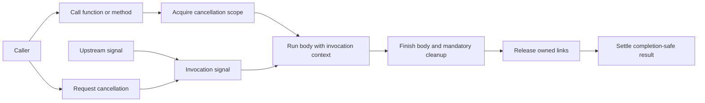

# ADR-0007: Cancellation function and method facades

## Status

Proposed for review. Requirements are targets, not evidence that this provider
already implements or exports the described facades. Acceptance, implementation,
verification, and publication are separate decisions.

## Context

### Background and Problem Statement

Contexts provides generic transformations and asynchronous function and standard
method adapters. Cancellation policy and its named conveniences belong to this
provider. The current root exposes a cancellation scope and primitives, but not
a named cancellable function or method decorator.

The historical contexts function and decorator returned a cancellable promise,
created a downstream signal, and selected eager or lazy settlement. The eager
form could settle before the wrapped work finished. These are useful migration
inputs, not an obligation to reproduce legacy parameter decorators or early
release. The original implementations are available at the historical
[function](https://github.com/MatrixAI/js-contexts/blob/9af3ce279308469f54edfed4ceca0ed06c0829df/src/functions/cancellable.ts)
and
[decorator](https://github.com/MatrixAI/js-contexts/blob/9af3ce279308469f54edfed4ceca0ed06c0829df/src/decorators/cancellable.ts).

The historical contexts manifest selected cancellation version 2. A review of
[cancellation version 2.0.1](https://github.com/MatrixAI/js-async-cancellable/blob/7c85f51ad65834805e9fe9bdfe3f728dbea78c33/src/PromiseCancellable.ts)
shows that the promise previously had implicit abort behavior and rewrote native
abort errors in its rejection path. It also supported explicitly shared
controllers. Version 4 instead documents request-only direct construction and
explicit waiting policies. A facade cannot assume the old promise's implicit
settlement or reason rewriting when using the new provider. Version 2.0.1 is a
reviewed compatible release, not a claim about the historical lockfile's exact
resolution.

[ADR-0004](../0004-contexts-provider-integration/adr.md) defines the provider
scope. [ADR-0006](../0006-waiting-and-owned-completion/adr.md) distinguishes
requests, selected results, and owned completion. Contexts ADR-0007, reviewed at
its selected provider revision, specifies asynchronous adapters with explicit
argument selection and standard decorators. Neither generic adapter supplies a
cancellation policy.

### A request that must finish cleaning up

An order service reads from a remote server on behalf of a request. If the
client disconnects, the service should pass the request downstream so the read
can stop. The service may still need to close a stream or release a connection
before its caller can safely treat the operation as complete. One request must
not gain authority to cancel another request or the upstream controller.



The request arrow is not a completion arrow. The body can observe cancellation
and reject, handle it and return a value, or continue until it completes. The
returned result remains pending until the represented body and mandatory cleanup
finish. This does not include work detached from the body's represented promise.

### One operation, two authoring forms

The following TypeScript-like examples illustrate the desired use; an unreleased
working-tree implementation exists, but its conformance is not established. The
required context argument is supplied by the caller, and the provider selects
its second argument, copies or transforms the context, and supplies the
invocation signal. The examples use separate function and decorator entrypoints
so both can use the concise name `cancellable`.

```typescript
import { cancellable } from '@matrixai/async-cancellable/functions';

type RequestContext = { traceId: string; signal: AbortSignal };

async function readOrder(
  orderId: string,
  context: RequestContext,
): Promise<string> {
  // Represents the read and its own mandatory cleanup.
  return await readFromServer(orderId, context.signal);
}

// Illustrative provider function; actual names and options are under review.
const readCancellable = cancellable(readOrder, { context: 1 });
const parent = new AbortController();
const result = readCancellable('order-1', {
  traceId: 'trace-1',
  signal: parent.signal,
});

result.cancel(new Error('client disconnected'));
await result; // Settles after the represented read and cleanup, not the request.
```

The provider's method form selects the same context position and applies the
same policy without a parameter decorator:

```typescript
import { cancellable } from '@matrixai/async-cancellable/decorators';

class OrderService {
  readonly prefix = 'orders';

  @cancellable({ context: 1 })
  async read(orderId: string, context: RequestContext): Promise<string> {
    return `${this.prefix}:${await readOrder(orderId, context)}`;
  }
}

const service = new OrderService();
const parent = new AbortController();
const result = service.read('order-1', {
  traceId: 'trace-1',
  signal: parent.signal,
});
parent.abort(new Error('client disconnected'));
await result;
```

The method is statically declared as returning an ordinary promise. Even if a
proposed decorator returns a cancellable promise at runtime, standard decoration
does not add a visible cancellation method to that declared type. The example
therefore uses the upstream controller rather than pretending the method's type
has changed. Whether the read rejects or returns after cancellation depends on
the read's own behavior; cancellation alone does not select its result.

These snippets are separate examples. When both forms are imported into the same
module, either import can be aliased; separate provider entrypoints avoid
requiring a longer decorator name. The entrypoints are proposed, not current
package exports.

### What changed from the historical form

The historical
[decorator tests](https://github.com/MatrixAI/js-contexts/blob/9af3ce279308469f54edfed4ceca0ed06c0829df/tests/decorators/cancellable.test.ts)
showed a method decorated with `@cancellable(true)` and a parameter marked
`@context`. An overload exposed a cancellable result and an optional context.
The new examples instead choose the position explicitly, keep the caller's
context argument present, and use completion-safe default settlement. They do
not imply that the old overloads, lazy flag, parameter metadata, or eager
default are retained.

## Decision Drivers

### Primary Decision Drivers

- Restore convenient provider-owned function and method authoring.
- Preserve directional cancellation and observable represented completion.

### Secondary Decision Drivers

- Keep function and decorator behavior aligned with the existing scope.
- Describe migration and type limitations without promising legacy
  compatibility.

## Considered Options

### Option 1: Require every consumer to compose generic adapters

**Advantages:** No additional public provider surface.

**Disadvantages:** Repeats provider policy and omits the requested convenience.

**Risk Assessment:** Consumers can accidentally conflate cancellation and work
completion.

### Option 2: Restore the historical implementation unchanged

**Advantages:** Familiar historical names and eager-settlement behavior.

**Disadvantages:** Requires legacy decorator conventions and can finalize an
owned boundary before represented work has finished.

**Risk Assessment:** Conflicts with current completion and decorator contracts.

### Option 3: Provide named facades over provider ownership

**Advantages:** Convenient call sites share current cancellation and scope
semantics with explicit completion.

**Disadvantages:** Standard method decorators do not automatically change the
static return type of a decorated method.

**Risk Assessment:** Bounded by provider-specific parity and ownership tests.

## Decision

Choose option 3. Add a `cancellable` function and a `cancellable` standard
method decorator in separate function and decorator entrypoints. Both take a
required `context` position, expressed as a nonnegative integer or `last`. The
function returns a completion-safe cancellable promise; the decorator keeps the
original method's static signature. Neither form offers an implicit
early-settlement option. The function and decorator implement one cancellation
policy, not competing execution engines. Their asynchronous contract does not
require timing or a dependency on the timer provider.

<a id="REQ-CANCEL-AUTHORING-001"></a>

### REQ-CANCEL-AUTHORING-001 - Named forms share one policy

Requirement status: target. Level: MUST. Verification: runtime and type cases.
Evidence status: unevidenced.

The provider MUST expose a named cancellable function adapter and a named
standard method decorator for promise-returning work. Both MUST use the same
cancellation-scope semantics and policy, preserve the receiver and non-context
arguments, and provide equivalent results, failures, and cleanup. Decorators
MUST NOT require parameter decorators or reflection metadata. Each form MUST
select a required context argument explicitly by zero-based position or `last`,
and reject invalid configuration and missing selected arguments before entering
work. Supported context, tuple, generic, and overload limits MUST be documented.
They MUST preserve unrelated compatible fields and MUST NOT claim to provide a
more refined signal than their source supplies.

<a id="REQ-CANCEL-AUTHORING-002"></a>

### REQ-CANCEL-AUTHORING-002 - A request is local and directional

Requirement status: target. Level: MUST. Verification: cancellation cases.
Evidence status: unevidenced.

Each invocation MUST have independent downstream cancellation authority. An
upstream signal is borrowed and propagates its first reason downstream without
granting authority over its source. An already-aborted input MUST enter the body
with the downstream signal already aborted, as required by ADR-0006. A request
through an offered result handle MUST reach that invocation's body signal and
MUST NOT cancel its parent or a sibling invocation. Signal identity between a
result handle and body MUST be documented rather than assumed.

<a id="REQ-CANCEL-AUTHORING-003"></a>

### REQ-CANCEL-AUTHORING-003 - Completion-safe default

Requirement status: target. Level: MUST. Verification: gated completion cases.
Evidence status: unevidenced.

The named facade's default result MUST settle only after represented body work
and mandatory owned cleanup complete. A cancellation request alone MUST NOT
force settlement or release. The functional form MUST provide a cancellable
result whose request authority targets that invocation. The method form MUST
have the same runtime request and completion semantics, while its declared
method return type MUST remain honest about what standard decoration can
express. Documentation MUST NOT imply that decorating a method typed as an
ordinary promise gives callers a statically visible cancellation method.

<a id="REQ-CANCEL-AUTHORING-004"></a>

### REQ-CANCEL-AUTHORING-004 - Early waiting is not owned completion

Requirement status: target. Level: MUST. Verification: policy and failure cases.
Evidence status: unevidenced.

If an early-settling authoring policy is offered, it MUST be explicitly selected
and MUST identify an independently accessible owner-observable completion
outcome covering represented work and mandatory cleanup. Early rejection MUST
NOT release the scope, discard later failures, or be called completion. A
borrowed wait remains subject to ADR-0006 and MUST NOT acquire source
cancellation authority merely because it stops waiting. This decision does not
require an early-settling facade to be offered.

<a id="REQ-CANCEL-AUTHORING-005"></a>

### REQ-CANCEL-AUTHORING-005 - Failures and release remain observable

Requirement status: target. Level: MUST. Verification: failure and cleanup
cases. Evidence status: unevidenced.

Acquisition failures MUST unwind acquired resources. Links and listeners owned
by an invocation MUST remain until represented body completion and mandatory
cleanup, then be released. Arbitrary body and cleanup failure values MUST retain
their identity and roles under the provider's documented combined-failure
contract. Detached work is not represented merely because the body started it.

### Required cases

Planned provider cases compare function and method forms at first, middle, and
last context positions; receiver and argument preservation; invalid and missing
selection; successful and failed bodies; pre-aborted entry and exact reasons;
concurrent siblings and directional requests; independently gated body and
cleanup; acquisition and simultaneous failure paths; and type-level supported
and rejected signatures. They check that the functional return exposes its
request authority and that decorator typing does not falsely add methods. If an
early policy is introduced, tests retain and inspect its actual completion. Run
these against this provider, not only the generic contexts adapter. Planned
cases are not evidence of execution.

## Consequences

### Positive

- Applications regain concise provider-owned cancellation authoring.
- Scope ownership and cancellation authority remain explicit.

### Negative

- Early waiting needs a separately observable completion when work is owned.
- Standard decorator typing cannot retroactively alter a method's signature.

### Neutral

- Timing and combined timing/cancellation remain downstream timer policies.
- Historical eager defaults and omitted context arguments are not presumed.

## Decision Outcome

Provider facades are proposed as an additive authoring surface over current
cancellation boundaries. The working-tree candidate uses the names and default
policy in the decision; the record remains proposed and does not authorize a
release or establish full conformance.

## Related Decisions

- [Contexts provider integration](../0004-contexts-provider-integration/adr.md).
- [Cancellable waiting and owned completion](../0006-waiting-and-owned-completion/adr.md).

## Links

- [Cancellation scope](../../src/utils.ts).
- [Cancellation promise](../../src/PromiseCancellable.ts).
- [Public entrypoint](../../src/index.ts).

## More Information

The scope provides an already-aborted signal to the body; this is not an
admission policy that skips body entry. Neither signal abortion nor a returned
cancellable promise represents untracked effects beyond the body contract.

## Audit

### 2026-11-11

**Status:** Pending

**Findings:**

| Finding                | Files                                   | Lines        | Assessment                                     |
| ---------------------- | --------------------------------------- | ------------ | ---------------------------------------------- |
| Named facade is absent | [Public entrypoint](../../src/index.ts) | Root exports | Proposed target has no provider implementation |

**Summary:** Historical implementation was inspected; provider facade cases and
implementation evidence do not yet exist.

**Action Required:** Review the public API and execution policies, validate this
record, and add provider-specific implementation and evidence after acceptance.

### 2026-11-11

**Status:** Pending

**Findings:** The unreleased working tree contains the proposed named function
and decorator, with direct package subpaths. Runtime and type cases cover local
requests, nesting, parent isolation, pre-aborted entry, gated completion, and
selected failure paths. Package self-reference is tested; an independent packed
consumer and full conformance review remain outstanding.

**Summary:** This later observation does not change the proposed decision or the
target and unevidenced requirement statuses.

**Action Required:** Complete the remaining package, failure, and conformance
review before changing requirement status or considering release.
